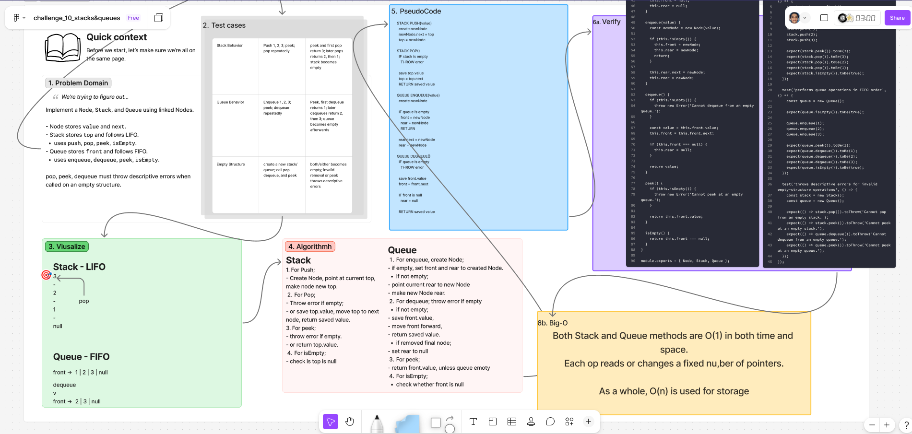

# ***Stack and Queue***

Implement a `Node`, `Stack`, and `Queue` using linked Nodes as the underlying data storage.

The Stack follows Last In, First Out (**LIFO**) behavior. The Queue follows First In, First Out (**FIFO**) behavior.

## Whiteboard Process

  

### [figma](https://www.figma.com/board/8F0dD8MbNzqGa2lWJiRNVD/challenge_10_stacks-queues?node-id=0-1&t=YDUp6VZMSMu6oWD2-1)

## Approach & Efficiency

### **Approach Explanation**

Both data structures use Nodes with `value` and `next` properties.

The Stack tracks only its `top` Node. Pushing adds a Node to the top, and popping removes the top Node.

The Queue tracks both its `front` and `rear` Nodes. The `front` is used for dequeue operations, while the `rear` allows enqueue operations to remain O(1).

Empty Stack and Queue operations throw descriptive errors.

### **The Big-O**

| Method | Time Complexity | Space Complexity |
|---|---:|---:|
| Stack `push`, `pop`, `peek`, `isEmpty` | O(1) | O(1) |
| Queue `enqueue`, `dequeue`, `peek`, `isEmpty` | O(1) | O(1) |

**Time Complexity:**

Each method changes or reads a fixed number of references. No method needs to traverse through every Node.

**Space Complexity:**

Each individual operation uses O(1) additional space. The Stack or Queue itself uses O(n) space because it stores one Node for each value.

## Solution

```js
class Node {
  constructor(value) {
    this.value = value;
    this.next = null;
  }
}

class Stack {
  constructor() {
    this.top = null;
  }

  push(value) {
    const newNode = new Node(value);
    newNode.next = this.top;
    this.top = newNode;
  }

  pop() {
    if (this.isEmpty()) {
      throw new Error('Cannot pop from an empty stack.');
    }

    const value = this.top.value;
    this.top = this.top.next;

    return value;
  }

  peek() {
    if (this.isEmpty()) {
      throw new Error('Cannot peek at an empty stack.');
    }

    return this.top.value;
  }

  isEmpty() {
    return this.top === null;
  }
}

class Queue {
  constructor() {
    this.front = null;
    this.rear = null;
  }

  enqueue(value) {
    const newNode = new Node(value);

    if (this.isEmpty()) {
      this.front = newNode;
      this.rear = newNode;
      return;
    }

    this.rear.next = newNode;
    this.rear = newNode;
  }

  dequeue() {
    if (this.isEmpty()) {
      throw new Error('Cannot dequeue from an empty queue.');
    }

    const value = this.front.value;
    this.front = this.front.next;

    if (this.front === null) {
      this.rear = null;
    }

    return value;
  }

  peek() {
    if (this.isEmpty()) {
      throw new Error('Cannot peek at an empty queue.');
    }

    return this.front.value;
  }

  isEmpty() {
    return this.front === null;
  }
}
```

### Example/Test

```js
const stack = new Stack();

stack.push('first');
stack.push('second');

stack.pop();
// 'second'

const queue = new Queue();

queue.enqueue('first');
queue.enqueue('second');

queue.dequeue();
// 'first'
```

<!-- CHECKLIST: Whiteboard Process -->

- [ ] Top-level README “Table of Contents” is updated
- [ ] README for this challenge is complete
  - [ ] Summary, Description, Approach & Efficiency, Solution
  - [ ] Picture of whiteboard
  - [ ] [Link to code](#solution)
- [ ] Feature tasks for this challenge are completed
- [ ] Unit tests written and passing
  - [ ] “Happy Path” - Expected outcome
  - [ ] Expected failure
  - [ ] Edge Case (if applicable/obvious)

<!----------------------------------------------------------------------------->
