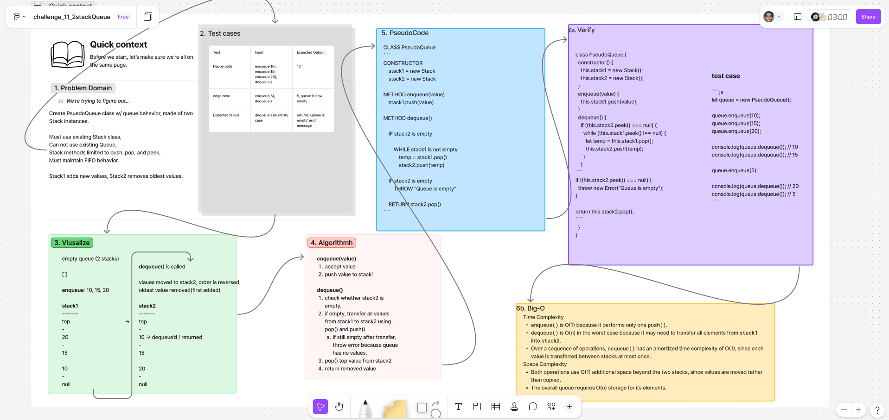

# ***2 Stacks Queue***

Implement a `PseudoQueue` class that uses two `Stack` instances to simulate a `Queue`.

The queue must follow the First In, First Out (**FIFO**) principle while using the Last In, First Out (**LIFO**) behavior of stacks.

## Whiteboard Process

  

### [figma](https://www.figma.com/board/EnnBABgYXTAlqOqajDTEYa/challenge_11_2stackQueue?node-id=0-1&t=kVceElVFrjie42FO-1)

## Approach & Efficiency

### **Approach Explanation**

The solution uses two stacks to maintain **FIFO** behavior.

For `enqueue(value)`, the new value is pushed directly onto `stack1`.

For `dequeue()`, if `stack2` is empty, all values are transferred from `stack1` into `stack2`. This reverses their order, placing the oldest value on top. The top value of `stack2` is then removed and returned.

Values are only transferred when `stack2` is empty, avoiding unnecessary repeated operations.

### **The Big-O**

|Operation|Time|Space|
|---|---|---|
|`enqueue`|O(1)|O(1)|
|`dequeue`|O(n)|O(1)|

**Time Complexity:**

Enqueue requires one push operation. Dequeue may require transferring all values between stacks, but has an amortized time complexity of O(1).

**Space Complexity:**

Both operations use constant auxiliary space. The overall queue requires O(n) storage.

## Solution

```js
class PseudoQueue {
  constructor() {
    this.stack1 = new Stack();
    this.stack2 = new Stack();
  }

  enqueue(value) {
    this.stack1.push(value);
  }

  dequeue() {
    if (this.stack2.peek() === null) {
      while (this.stack1.peek() !== null) {
        let temp = this.stack1.pop();
        this.stack2.push(temp);
      }
    }

    if (this.stack2.peek() === null) {
      throw new Error("Queue is empty");
    }

    return this.stack2.pop();
  }
}
```

### Example/Test

```js
let queue = new PseudoQueue();

queue.enqueue(10);
queue.enqueue(15);
queue.enqueue(20);

queue.dequeue(); // 10
queue.dequeue(); // 15

queue.enqueue(5);

queue.dequeue(); // 20
queue.dequeue(); // 5
```

<!-- CHECKLIST: Whiteboard Process -->

- [ ] Top-level README “Table of Contents” is updated
- [ ] README for this challenge is complete
  - [ ] Summary, Description, Approach & Efficiency, Solution
  - [ ] Picture of whiteboard
  - [ ] [Link to code](#solution)
- [ ] Feature tasks for this challenge are completed
- [ ] Unit tests written and passing
  - [ ] “Happy Path” - Expected outcome
  - [ ] Expected failure
  - [ ] Edge Case (if applicable/obvious)

<!----------------------------------------------------------------------------->
