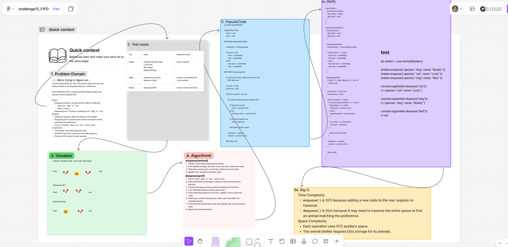

# ***FIFO Shelter***

Implement an `AnimalShelter` class that stores `dogs` and `cats` and operates using *First In, First Out* (**FIFO**) behavior.

The shelter allows animals to be added and adopted based on a specified species preference. When an animal is requested, the oldest animal matching that preference is removed and returned.

`enqueue(animal)` — Adds a `dog` or `cat` object to the shelter.

`dequeue(pref)` — Removes and returns the oldest animal matching `"dog"` or `"cat"`.

Returns `null` for an invalid preference or when no matching animal is available.

## Whiteboard Process

  

### [figma](https://www.figma.com/board/uhlVSr33hG9EgilNUZqARj/challenge12_FIFO?node-id=0-1&t=R7bkmkW3PywA1u29-1)

## Approach & Efficiency

### **Approach Explanation**

The solution uses a `linked-list queue` with *front* and *rear* pointers.

For `enqueue(animal)`, a new node containing the animal is added to the rear of the queue.

For `dequeue(pref)`, the queue is traversed from the front until the first animal matching the preference is found. That animal is removed, and the remaining nodes stay in their original order.

### **The Big-O**

|Operation|Time|Space|
|---|---|---|
|`enqueue`|O(1)|O(1)|
|`dequeue`|O(n)|O(1)|

**Time Complexity:**  
Enqueue adds a node directly to the rear. Dequeue may need to traverse all animals to find a match.

**Space Complexity:**  
Both operations use constant auxiliary space. The overall shelter requires O(n) storage.

## Solution


```js
class Node {
  constructor(value) {
    this.value = value;
    this.next = null;
  }
}

class AnimalShelter {
  constructor() {
    this.front = null;
    this.rear = null;
  }

  enqueue(animal) {
    let newNode = new Node(animal);

    if (this.front === null) {
      this.front = newNode;
      this.rear = newNode;
    } else {
      this.rear.next = newNode;
      this.rear = newNode;
    }
  }

  dequeue(pref) {
    if (pref !== "dog" && pref !== "cat") {
      return null;
    }

    let current = this.front;
    let previous = null;

    while (current !== null) {
      if (current.value.species === pref) {
        if (previous === null) {
          this.front = current.next;
        } else {
          previous.next = current.next;
        }

        if (current === this.rear) {
          this.rear = previous;
        }

        return current.value;
      }

      previous = current;
      current = current.next;
    }

    return null;
  }
}
```

### Test/example

```js
let shelter = new AnimalShelter();

shelter.enqueue({ species: "dog", name: "Buddy" });
shelter.enqueue({ species: "cat", name: "Luna" });
shelter.enqueue({ species: "dog", name: "Max" });

console.log(shelter.dequeue("cat"));
// { species: "cat", name: "Luna" }

console.log(shelter.dequeue("dog"));
// { species: "dog", name: "Buddy" }

console.log(shelter.dequeue("bird"));
// null
```

<!-- CHECKLIST: Whiteboard Process -->

- [ ] Top-level README “Table of Contents” is updated
- [ ] README for this challenge is complete
  - [ ] Summary, Description, Approach & Efficiency, Solution
  - [ ] Picture of whiteboard
  - [ ] [Link to code](#solution)
- [ ] Feature tasks for this challenge are completed
- [ ] Unit tests written and passing
  - [ ] “Happy Path” - Expected outcome
  - [ ] Expected failure
  - [ ] Edge Case (if applicable/obvious)

<!----------------------------------------------------------------------------->
