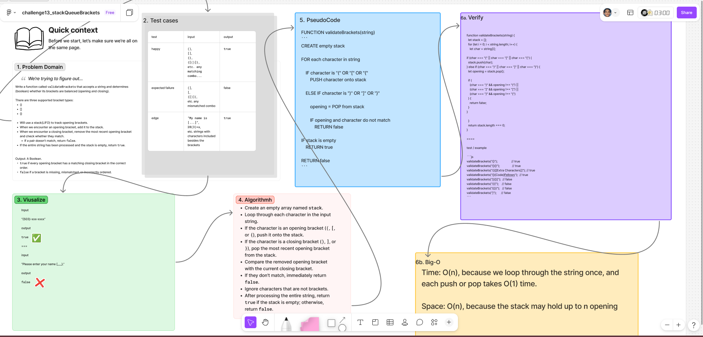

# ***Stack Queue Brackets***

Write a function called `validateBrackets` that *accepts a string* and *returns a Boolean* indicating whether its brackets are balanced.

The function supports three bracket types:  
Round brackets: **()**  
Square brackets: **[]**  
Curly brackets: **{}**  

Brackets must be correctly matched and nested. Characters that are not brackets are ignored.

## Whiteboard Process

  

### [figma](https://www.figma.com/board/J4YLuad193rBJBPZgnQXwM/challenge13_stackQueueBrackets?node-id=0-1&t=hNCW96iy4C9mYXjm-1)

## Approach & Efficiency

### **Approach Explanation**

The solution uses a **stack** to track opening brackets.

Each character in the input string is examined. Opening brackets are pushed onto the stack, while closing brackets are compared against the most recently opened bracket using `pop()`.

If a pair does not match, the function returns `false`. After processing the string, the function returns `true` only if the stack is empty.

### **The Big-O**

|Complexity|Big(O)|
|---|---|
|Time|O(1)|
|Space|O(n)|

**Time Complexity:**  
O(n), because each character is examined once.

**Space Complexity:**  
O(n), because the stack may store up to n opening brackets.

## Solution

```js
function validateBrackets(string) {
  let stack = [];

  for (let i = 0; i < string.length; i++) {
    let char = string[i];

    if (char === "(" || char === "[" || char === "{") {
      stack.push(char);
    } else if (char === ")" || char === "]" || char === "}") {
      let opening = stack.pop();

      if (
        (char === ")" && opening !== "(") ||
        (char === "]" && opening !== "[") ||
        (char === "}" && opening !== "{")
      ) {
        return false;
      }
    }
  }

  return stack.length === 0;
}
```

### test/example

```js
validateBrackets("{[()]}"); // true
validateBrackets("{}{}");   // true
validateBrackets("[(])");   // false
validateBrackets("(((");    // false
```
<!-- CHECKLIST: Whiteboard Process -->

- [ ] Top-level README “Table of Contents” is updated
- [ ] README for this challenge is complete
  - [ ] Summary, Description, Approach & Efficiency, Solution
  - [ ] Picture of whiteboard
  - [ ] [Link to code](#solution)
- [ ] Feature tasks for this challenge are completed
- [ ] Unit tests written and passing
  - [ ] “Happy Path” - Expected outcome
  - [ ] Expected failure
  - [ ] Edge Case (if applicable/obvious)

<!----------------------------------------------------------------------------->
