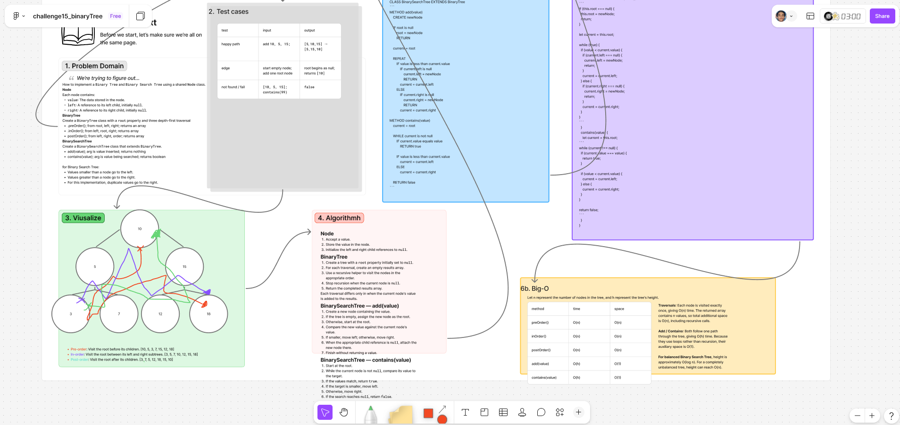

# ***binaryTree***

Implement a `Binary Tree` and `Binary Search Tree` using JavaScript classes.

The implementation includes a `Node` class, a `BinaryTree` class with three depth-first traversal methods, and a `BinarySearchTree` subclass with methods for adding and searching for values.

- **`Node`** — Stores a value and references to left and right children.
- **`BinaryTree`** — Supports *pre-order*, *in-order*, and *post-order* traversals.
- **`BinarySearchTree`** — Extends `BinaryTree` with `add(value)` and `contains(value)` methods.

## Whiteboard Process

  

### [figma](https://www.figma.com/board/9uEKte2Bimqn8BkHpwJWLi/challenge15_binaryTree?node-id=0-1&t=hNCW96iy4C9mYXjm-1)

## Approach & Efficiency

### **Approach Explanation**

The solution uses a shared `Node` class and inheritance to implement both tree structures.

The `BinaryTree` class uses recursive helper methods for depth-first traversals. Each traversal returns an *array* of node values in the required order.

The `BinarySearchTree` class *extends* `BinaryTree` and uses iterative comparisons to insert and search for values while maintaining Binary Search Tree ordering.

### **The Big-O**

- `n` represents the number of nodes in the tree, and `h` represents the tree's height.

|Operation|Time|Space|
|---|---|---|
|pre-order|O(n)|O(n)|
|in-order|O(n)|O(n)|
|post-order|O(n)|O(n)|
|add|O(h)|O(1)|
|contains|O(h)|O(1)|


**Time Complexity:**

Traversals visit every node. Add and contains follow one path through the tree.

**Space Complexity:**

Traversals store results and use recursive calls. Add and contains use constant auxiliary space.

## Solution

```js
class Node {
  constructor(value) {
    this.value = value;
    this.left = null;
    this.right = null;
  }
}

class BinaryTree {
  constructor() {
    this.root = null;
  }

  preOrder() {
    let results = [];
    this.traversePreOrder(this.root, results);
    return results;
  }

  traversePreOrder(node, results) {
    if (node === null) return;

    results.push(node.value);
    this.traversePreOrder(node.left, results);
    this.traversePreOrder(node.right, results);
  }

  inOrder() {
    let results = [];
    this.traverseInOrder(this.root, results);
    return results;
  }

  traverseInOrder(node, results) {
    if (node === null) return;

    this.traverseInOrder(node.left, results);
    results.push(node.value);
    this.traverseInOrder(node.right, results);
  }

  postOrder() {
    let results = [];
    this.traversePostOrder(this.root, results);
    return results;
  }

  traversePostOrder(node, results) {
    if (node === null) return;

    this.traversePostOrder(node.left, results);
    this.traversePostOrder(node.right, results);
    results.push(node.value);
  }
}

class BinarySearchTree extends BinaryTree {
  add(value) {
    let newNode = new Node(value);

    if (this.root === null) {
      this.root = newNode;
      return;
    }

    let current = this.root;

    while (true) {
      if (value < current.value) {
        if (current.left === null) {
          current.left = newNode;
          return;
        }
        current = current.left;
      } else {
        if (current.right === null) {
          current.right = newNode;
          return;
        }
        current = current.right;
      }
    }
  }

  contains(value) {
    let current = this.root;

    while (current !== null) {
      if (current.value === value) {
        return true;
      }

      if (value < current.value) {
        current = current.left;
      } else {
        current = current.right;
      }
    }

    return false;
  }
}
```

### example / jest

```js
let tree = new BinarySearchTree();

tree.add(10);
tree.add(5);
tree.add(15);
tree.add(3);
tree.add(7);
tree.add(12);
tree.add(18);

console.log(tree.preOrder());
// [10, 5, 3, 7, 15, 12, 18]

console.log(tree.inOrder());
// [3, 5, 7, 10, 12, 15, 18]

console.log(tree.postOrder());
// [3, 7, 5, 12, 18, 15, 10]

console.log(tree.contains(12)); // true
console.log(tree.contains(99)); // false
```

<!-- CHECKLIST: Whiteboard Process -->

- [ ] Top-level README “Table of Contents” is updated
- [ ] README for this challenge is complete
  - [ ] Summary, Description, Approach & Efficiency, Solution
  - [ ] Picture of whiteboard
  - [ ] [Link to code](#solution)
- [ ] Feature tasks for this challenge are completed
- [ ] Unit tests written and passing
  - [ ] “Happy Path” - Expected outcome
  - [ ] Expected failure
  - [ ] Edge Case (if applicable/obvious)

<!----------------------------------------------------------------------------->
