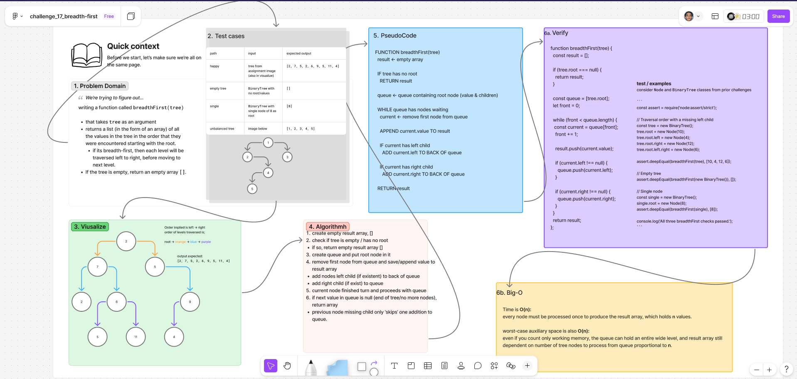

# ***Breadth-first Traversal***

Writing a function called `breadthFirst(tree)` 

that takes `tree` as an argument and returns a *list* (in the form of an **[array]**) of all the values in the tree in the order that they were encountered, starting with the root.  

Each level will be traversed left to right, before moving to next level.  
If the tree is empty, return an empty array `[]`.

## Whiteboard Process

  

### [figma](https://www.figma.com/board/vugGG7tlIY1gb37lHGAL1t/challenge_17_breadth-first?node-id=0-1&t=9xHH0di0H2OB2Lkn-1)

## Approach & Efficiency

### **Approach Explanation**

As tree nodes are traversed through, starting with the root, it and it's children are added to a `queue` (FIFO). Subsequent nodes are added to the queue when its parent is visited / processed, left child first -> right child after.

From where the node at the front will be removed and then taken to the `results` array.  

`front` will be used to mark the next node waiting in the queue. During each visit, the code reads the node at `front`, advances `front`, and appends the node’s value to `result`. The node itself stays in the queue array.  

Checks are done for its children of a node to make sure it has either left or right children and add them to the queue.

Once `front` reaches `queue.length`, every node in the tree will have been traversed and processed to the results array and the array will be returned.

### **The Big-O**

**Time Complexity: O(n)**  
every node must be processed once to produce the result array, which holds n values.

**Space Complexity: O(n)**  
The queue retains one reference per node as `front` advances, so it uses O(n) auxiliary space.  
The returned array separately stores n values.  

## Solution

```js
function breadthFirst(tree) {
  const result = [];

  if (tree.root === null) {
    return result;
  }

  const queue = [tree.root];
  let front = 0;

  while (front < queue.length) {
   const current = queue[front];
    front += 1;

    result.push(current.value);

    if (current.left !== null) {
      queue.push(current.left);    }

    if (current.right !== null) {
      queue.push(current.right);
    }
  }
  return result;
};
```

### verification examples

Checks use built-in assertions from Node, as well as `Node` and `BinaryTree` classes from challenge prior.

```js
const assert = require('node:assert/strict');

// Traversal order with a missing left child
const tree = new BinaryTree();
tree.root = new Node(10);
tree.root.left = new Node(4);
tree.root.right = new Node(12);
tree.root.left.right = new Node(6);

assert.deepEqual(breadthFirst(tree), [10, 4, 12, 6]);

// Empty tree
assert.deepEqual(breadthFirst(new BinaryTree()), []);

// Single node
const single = new BinaryTree();
single.root = new Node(8);
assert.deepEqual(breadthFirst(single), [8]);

console.log('All three breadthFirst checks passed.');
```
<!-- CHECKLIST: Whiteboard Process -->

- [ ] Top-level README “Table of Contents” is updated
- [ ] README for this challenge is complete
  - [ ] Summary, Description, Approach & Efficiency, Solution
  - [ ] Picture of whiteboard
  - [ ] [Link to code](#solution)
- [ ] Feature tasks for this challenge are completed
- [ ] Unit tests written and passing
  - [ ] “Happy Path” - Expected outcome
  - [ ] Expected failure
  - [ ] Edge Case (if applicable/obvious)

<!----------------------------------------------------------------------------->
