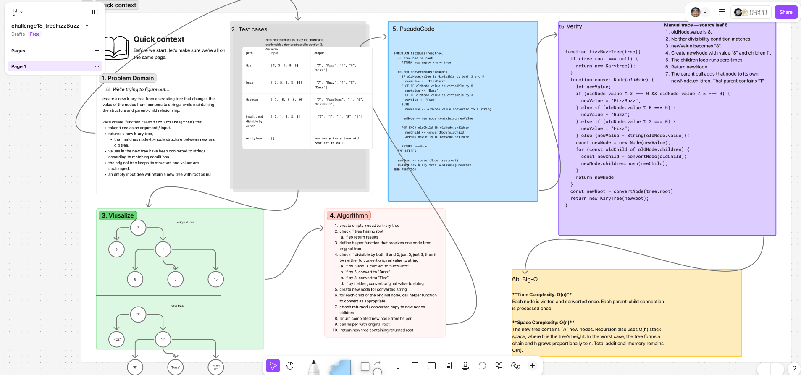

# ***treeFizzBuzz***

Create a new k-ary tree from an existing tree that changes the value of the nodes from numbers to "strings", while maintaining the structure and parent-child relationship.

We’ll create  function called `fizzBuzzTree(tree)` that,  
takes `tree` as an argument / input,  
returns a new k-ary tree,  
matches node-to-node structure between new and old tree.  

values in the new tree will be converted to strings according to matching conditions.  
the original tree keeps its structure and values are unchanged.
an empty input tree will return a new tree with root as null

## Whiteboard Process

  

### [figma](https://www.figma.com/board/esFe4nk6odlpJRO5pY9NIq/challenge18_treeFizzBuzz?node-id=0-1&t=janiv4jsBA9Cxp42-1)

## Approach & Efficiency

### **Approach Explanation**

If the original tree has no root, return a new empty `KaryTree`.

The solution uses recursive depth-first traversal. The helper `convertNode(oldNode)` chooses the appropriate FizzBuzz string and creates a new node containing it.

For each original child, the helper recursively creates its converted copy. Each returned copy is attached to the new parent’s `children` array in the original order. The helper then returns the completed new node.

The first helper call receives the original root. Its returned node becomes the root of the new tree. Each node is newly created, preserving the original tree’s values and structure.

### **The Big-O**

**Time Complexity: O(n)**  
Each node is visited and converted once. Each parent-child connection is processed once.

**Space Complexity: O(n)**  
The new tree contains `n` new nodes. Recursion also uses O(h) stack space, where h is the tree’s height. In the worst case, the tree forms a chain and h grows proportionally to n. Total additional memory remains O(n).

## Solution

```js
function fizzBuzzTree(tree){
  if (tree.root === null) {
    return new KaryTree();
  }

  function convertNode(oldNode) {
    let newValue;

    if (oldNode.value % 3 === 0 && oldNode.value % 5 === 0) {
      newValue = "FizzBuzz";
    } else if (oldNode.value % 5 === 0) {
      newValue = "Buzz";
    } else if (oldNode.value % 3 === 0) {
      newValue = "Fizz";
    } else {newValue = String(oldNode.value)};


    const newNode = new Node(newValue);

    for (const oldChild of oldNode.children) {
      const newChild = convertNode(oldChild);
      newNode.children.push(newChild);
    }

    return newNode
  }

  const newRoot = convertNode(tree.root)
  return new KaryTree(newRoot);
}
```

### Verification examples

oldNode.value is 8.
Neither divisibility condition matches.
newValue becomes "8".
Create newNode with value "8" and children [].
The children loop runs zero times.
Return newNode.
The parent call adds that node to its ownnewNode.children. That parent contains "1".

<!-- CHECKLIST: Whiteboard Process -->

- [ ] Top-level README “Table of Contents” is updated
- [ ] README for this challenge is complete
  - [ ] Summary, Description, Approach & Efficiency, Solution
  - [ ] Picture of whiteboard
  - [ ] [Link to code](#solution)
- [ ] Feature tasks for this challenge are completed
- [ ] Unit tests written and passing
  - [ ] “Happy Path” - Expected outcome
  - [ ] Expected failure
  - [ ] Edge Case (if applicable/obvious)

<!----------------------------------------------------------------------------->
