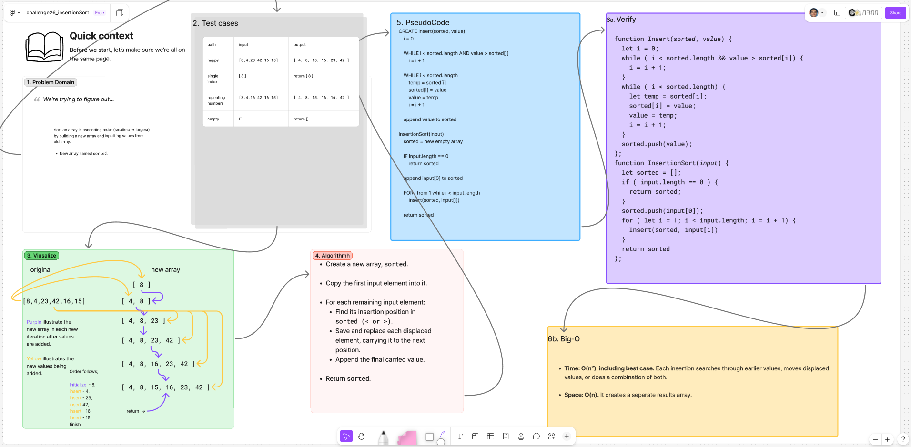

# ***Insertion Sort***

## Whiteboard Process

Given an array of integers, return a new array containing the same values sorted in ascending order, from smallest to largest.  

For example,  
`[8, 4, 23, 42, 16, 15]`  
produces  
`[4, 8, 15, 16, 23, 42]`.  

Duplicate values are preserved, and an empty input returns an empty array.

  

### [figma](https://www.figma.com/board/SgZDWQzw6RqckqXqoHlZIs/challenge26_insertionSort?node-id=0-1&t=VqLDLK2ccLHVujub-1)

## Approach & Efficiency

### **Approach Explanation**

Build a new array named `sorted`, beginning with the first input value.  
For each remaining value, find its insertion position, then save and replace displaced elements while carrying each displaced value forward.  
Append the final carried value. This keeps `sorted` in ascending order after every insertion; `Insert` handles each insertion, and `InsertionSort` processes the input.

### **The Big-O**

**Time Complexity: O(n²), including best case**  
Each insertion searches through earlier values, moves displaced values, or does a combination of both.

**Space Complexity: O(n)**  
It creates a separate results array.

## Solution

```js
function Insert(sorted, value) {
  let i = 0;

  while ( i < sorted.length && value > sorted[i]) {
    i = i + 1;
  }

  while ( i < sorted.length) {
    let temp = sorted[i];
    sorted[i] = value;
    value = temp;
    i = i + 1;
  }

  sorted.push(value);
};

function InsertionSort(input) {
  let sorted = [];

  if ( input.length == 0 ) {
    return sorted;
  }

  sorted.push(input[0]);

  for ( let i = 1; i < input.length; i = i + 1) {
    Insert(sorted, input[i])
  }

  return sorted
};

```

### Test / examples

These checks use Node’s built-in assertions. Run them with the solution functions defined above.

```js
const assert = require('node:assert/strict');

// Assignment sample
assert.deepEqual(
  InsertionSort([8, 4, 23, 42, 16, 15]),
  [4, 8, 15, 16, 23, 42]
);

// Reverse-sorted, including a negative number
assert.deepEqual(
  InsertionSort([20, 18, 12, 8, 5, -2]),
  [-2, 5, 8, 12, 18, 20]
);

// Few unique values
assert.deepEqual(
  InsertionSort([5, 12, 7, 5, 5, 7]),
  [5, 5, 5, 7, 7, 12]
);

// Nearly sorted
assert.deepEqual(
  InsertionSort([2, 3, 5, 7, 13, 11]),
  [2, 3, 5, 7, 11, 13]
);

// Empty, single-element, and already-sorted arrays
assert.deepEqual(InsertionSort([]), []);
assert.deepEqual(InsertionSort([8]), [8]);
assert.deepEqual(InsertionSort([1, 2, 3]), [1, 2, 3]);

// Return a separate array without changing the input
const input = [3, 1, 2];
const result = InsertionSort(input);

assert.deepEqual(result, [1, 2, 3]);
assert.deepEqual(input, [3, 1, 2]);
assert.notStrictEqual(result, input);

console.log('All insertion sort checks passed.');
```

<!-- CHECKLIST: Whiteboard Process -->

- [ ] Top-level README “Table of Contents” is updated
- [ ] README for this challenge is complete
  - [ ] Summary, Description, Approach & Efficiency, Solution
  - [ ] Picture of whiteboard
  - [ ] [Link to code](#solution)
- [ ] Feature tasks for this challenge are completed
- [ ] Unit tests written and passing
  - [ ] “Happy Path” - Expected outcome
  - [ ] Expected failure
  - [ ] Edge Case (if applicable/obvious)

<!----------------------------------------------------------------------------->
