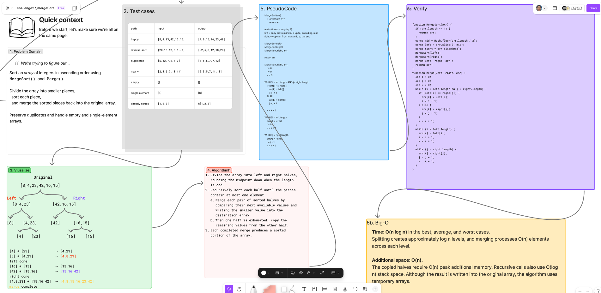

# ***MergeSort***

## Whiteboard Process

Sort the values of an array in ascending order using `MergeSort()`. 

`[8, 4, 23, 42, 16, 15]` becomes   
`[4, 8, 15, 16, 23, 42]`.

The function updates and returns the original array, preserves duplicates, and handles empty and single-element arrays through the test case shown in the whiteboard.

  

### [figma](https://www.figma.com/board/yPuZ7dwMgG0crhzlmc78Tt/challenge27_mergeSort?node-id=4842-673&t=TOxRsl9wFH0gTmFA-1)

## Approach & Efficiency

### **Approach Explanation**

Split the array into `left` and `right` halves, then recursively sort each half until each piece contains at most one element.  
Merge the sorted halves by comparing their next available values and writing the smaller value into the destination array.  
Once either half is exhausted, copy the remaining values from the other half.  
Repeating this process combines small sorted pieces into the fully sorted array; `MergeSort` handles splitting, and `Merge` combines the results.

### **The Big-O**

**Time Complexity: O(n log n)**  
in the best, average, and worst cases. 
Splitting creates approximately log n levels, and merging processes O(n) elements across each level.

**Space Complexity: O(n)**  
The copied halves require O(n) peak additional memory. Recursive calls also use O(log n) stack space. Although the result is written into the original array, the algorithm uses temporary arrays.

## Solution

```js
function MergeSort(arr) {
  if (arr.length <= 1) {
    return arr;
  }

  const mid = Math.floor(arr.length / 2);
  const left = arr.slice(0, mid);
  const right = arr.slice(mid);

  MergeSort(left);
  MergeSort(right);
  Merge(left, right, arr);

  return arr;
}

function Merge(left, right, arr) {
  let i = 0;
  let j = 0;
  let k = 0;

  while (i < left.length && j < right.length) {
    if (left[i] <= right[j]) {
      arr[k] = left[i];
      i = i + 1;
    } else {
      arr[k] = right[j];
      j = j + 1;
    }

    k = k + 1;
  }

  while (i < left.length) {
    arr[k] = left[i];
    i = i + 1;
    k = k + 1;
  }

  while (j < right.length) {
    arr[k] = right[j];
    j = j + 1;
    k = k + 1;
  }
}
```

### test / examples

```js
const assert = require('node:assert/strict');

const cases = [
  {
    name: 'assignment sample',
    input: [8, 4, 23, 42, 16, 15],
    expected: [4, 8, 15, 16, 23, 42]
  },
  {
    name: 'reverse sorted',
    input: [20, 18, 12, 8, 5, -2],
    expected: [-2, 5, 8, 12, 18, 20]
  },
  {
    name: 'few uniques',
    input: [5, 12, 7, 5, 5, 7],
    expected: [5, 5, 5, 7, 7, 12]
  },
  {
    name: 'nearly sorted',
    input: [2, 3, 5, 7, 13, 11],
    expected: [2, 3, 5, 7, 11, 13]
  },
  { name: 'empty', input: [], expected: [] },
  { name: 'single element', input: [8], expected: [8] },
  { name: 'already sorted', input: [1, 2, 3], expected: [1, 2, 3] },
  { name: 'all equal', input: [5, 5, 5], expected: [5, 5, 5] },
  { name: 'two elements', input: [2, 1], expected: [1, 2] },
  {
    name: 'odd length',
    input: [9, 1, 5, 3, 7],
    expected: [1, 3, 5, 7, 9]
  }
];

for (const { name, input, expected } of cases) {
  const result = MergeSort(input);

  assert.deepEqual(result, expected, name);
  assert.strictEqual(result, input, `${name}: returns the input array`);
}

// Exercise copying leftovers from either side.
const leftRemaining = [];
Merge([1, 3], [2], leftRemaining);
assert.deepEqual(leftRemaining, [1, 2, 3]);

const rightRemaining = [];
Merge([2], [1, 3], rightRemaining);
assert.deepEqual(rightRemaining, [1, 2, 3]);

console.log('All merge sort checks passed.');
```


<!-- CHECKLIST: Whiteboard Process -->

- [ ] Top-level README “Table of Contents” is updated
- [ ] README for this challenge is complete
  - [ ] Summary, Description, Approach & Efficiency, Solution
  - [ ] Picture of whiteboard
  - [ ] [Link to code](#solution)
- [ ] Feature tasks for this challenge are completed
- [ ] Unit tests written and passing
  - [ ] “Happy Path” - Expected outcome
  - [ ] Expected failure
  - [ ] Edge Case (if applicable/obvious)

<!----------------------------------------------------------------------------->
