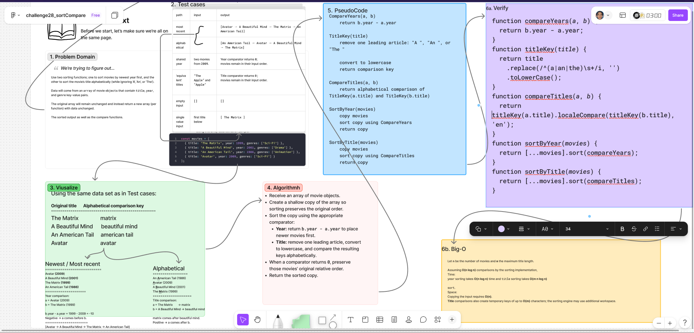

# ***Compare***

## Whiteboard Process

Given an array of movie objects containing `title`, `year`, and `genres`; return movies sorted either by ***newest year first*** or ***alphabetically by title***.  
Ignore leading “A”, “An”, or “The”.  
Each function returns a **new array** without changing the original array’s order or the movie objects.  
Separate comparator functions determine ordering and can be tested directly.

  

### [figma](https://www.figma.com/board/afnqDXBbjJEzCs3wbETs3Y/challenge28_sortCompare?node-id=0-1&t=L6QL8g5Pam080e3O-1)

## Approach & Efficiency

### **Approach Explanation**

Use separate comparators for **years** and **titles**.  

Compare years with `b.year - a.year` to place newer movies first.  

For titles;  
remove one leading article and convert the title to lowercase to create a comparison key,  
then compare keys alphabetically with `localeCompare`.  

Each sorting function copies the input array, sorts the copy using its comparator, and returns it.  
Movies with equal comparison keys retain their original relative order.

### **The Big-O**

Let `n` be the number of movies and `m` the maximum title length. 

Assuming **O(n log n)** comparisons by the sorting implementation.

**Time Complexity:**  
`year` sorting takes **O(n log n)** time and `title` sorting takes **O(m n log n)**.  

**Space Complexity:**  
Copying the input requires **O(n)**.
Title comparisons also create temporary keys of up to **O(m)** characters; the sorting engine may use additional workspace.

## Solution


```js
function compareYears(a, b) {
  return b.year - a.year;
}

function titleKey(title) {
  return title
    .replace(/^(a|an|the)\s+/i, '')
    .toLowerCase();
}

function compareTitles(a, b) {
  return titleKey(a.title).localeCompare(titleKey(b.title), 'en');
}

function sortByYear(movies) {
  return [...movies].sort(compareYears);
}

function sortByTitle(movies) {
  return [...movies].sort(compareTitles);
}
```

### test / examples

```js
const assert = require('node:assert/strict');

const movies = [
  { title: 'The Matrix', year: 1999, genres: ['Sci-Fi'] },
  { title: 'A Beautiful Mind', year: 2001, genres: ['Drama'] },
  { title: 'An American Tail', year: 1986, genres: ['Animation'] },
  { title: 'Avatar', year: 2009, genres: ['Sci-Fi'] }
];

const original = movies.map(movie => ({
  ...movie,
  genres: [...movie.genres]
}));

const byYear = sortByYear(movies);
const byTitle = sortByTitle(movies);

// Complete sorted outputs
assert.deepEqual(
  byYear.map(movie => movie.title),
  ['Avatar', 'A Beautiful Mind', 'The Matrix', 'An American Tail']
);

assert.deepEqual(
  byTitle.map(movie => movie.title),
  ['An American Tail', 'Avatar', 'A Beautiful Mind', 'The Matrix']
);

// Year comparator: negative, positive, and zero
assert.ok(compareYears({ year: 2024 }, { year: 2000 }) < 0);
assert.ok(compareYears({ year: 2000 }, { year: 2024 }) > 0);
assert.equal(compareYears({ year: 2000 }, { year: 2000 }), 0);

// Title comparator: negative, positive, and zero
assert.ok(compareTitles(
  { title: 'The Apple' },
  { title: 'A Banana' }
) < 0);

assert.ok(compareTitles(
  { title: 'A Banana' },
  { title: 'The Apple' }
) > 0);

assert.equal(compareTitles(
  { title: 'An Apple' },
  { title: 'Apple' }
), 0);

// Article handling and capitalization
assert.equal(titleKey('A Beautiful Mind'), 'beautiful mind');
assert.equal(titleKey('An American Tail'), 'american tail');
assert.equal(titleKey('The Matrix'), 'matrix');
assert.equal(titleKey('tHe Matrix'), 'matrix');
assert.equal(titleKey('Avatar'), 'avatar');
assert.equal(titleKey('Batman: The Movie'), 'batman: the movie');

// Edge cases for both sorting functions
for (const sortMovies of [sortByYear, sortByTitle]) {
  assert.deepEqual(sortMovies([]), []);

  const single = [movies[0]];
  const result = sortMovies(single);

  assert.deepEqual(result, single);
  assert.notStrictEqual(result, single);
}

// Equal keys retain their original order
const tied = [
  { title: 'The Apple', year: 2000, genres: [] },
  { title: 'Apple', year: 2000, genres: [] }
];

assert.deepEqual(sortByYear(tied), tied);
assert.deepEqual(sortByTitle(tied), tied);

// Preserve the original input and return separate arrays
assert.deepEqual(movies, original);
assert.notStrictEqual(byYear, movies);
assert.notStrictEqual(byTitle, movies);

// Preserve the movie objects themselves
assert.strictEqual(byYear[0], movies[3]);

console.log('All movie sorting checks passed.');
```
<!-- CHECKLIST: Whiteboard Process -->

- [ ] Top-level README “Table of Contents” is updated
- [ ] README for this challenge is complete
  - [ ] Summary, Description, Approach & Efficiency, Solution
  - [ ] Picture of whiteboard
  - [ ] [Link to code](#solution)
- [ ] Feature tasks for this challenge are completed
- [ ] Unit tests written and passing
  - [ ] “Happy Path” - Expected outcome
  - [ ] Expected failure
  - [ ] Edge Case (if applicable/obvious)

<!----------------------------------------------------------------------------->
